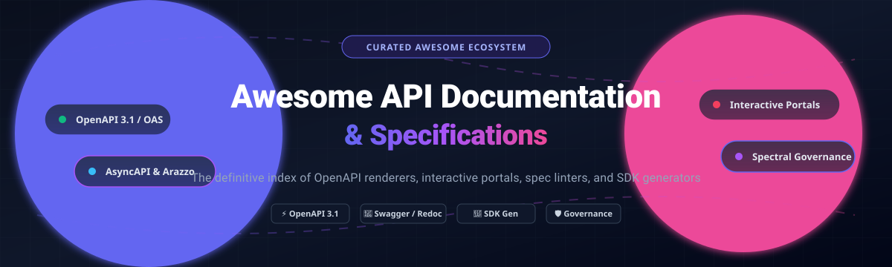

  

# 📚 Awesome API Documentation & Specifications

> 🚀 **The definitive curated index of OpenAPI 3.1 & Swagger renderers, interactive developer portals, API spec linters, mock servers, and automated SDK generators.**

  
  
  
  
  
  

---

### 🌐 Overview & Purpose

This repository tracks standout **SaaS platforms** and **open-source developer tools** for **API Documentation & Specifications**. These solutions empower API platform teams, technical writers, and developer experience (DevEx / DX) engineers to design, validate, render, and govern specifications—converting OpenAPI (OAS 3.0 / 3.1), AsyncAPI, and Arazzo definitions into interactive reference portals, type-safe client SDKs, mock servers, and automated CI/CD governance checks that stay synchronized with backend implementations.

* **Key SaaS Leaders**: ReadMe, Postman, Stoplight, SwaggerHub, Redocly, Mintlify, Document360, GitBook, Apiary, and Speakeasy.
* **Open-Source Standard**: Production-ready tools including Swagger UI, Redoc, Scalar, OpenAPI Generator, Spectral, Docusaurus, Slate, and AsyncAPI for transparent, self-hosted, vendor-independent developer platforms.

---

## 📑 Table of Contents

- [📊 Sector Overview & Market Dynamics](#-sector-overview--market-dynamics)
- [💼 SaaS / Hosted Platforms](#-saashosted-platforms)
- [🛠️ Open-Source GitHub Projects](#️-open-source-github-projects)
- [📈 Star History](#-star-history)
- [🤝 Support & Sponsorship](#-support--sponsorship)
- [✍️ How to Contribute](#️-how-to-contribute)
- [⚖️ Disclaimer](#️-disclaimer)

---

## 📊 Sector Overview & Market Dynamics

The global API management and documentation sector is estimated at **$8.5B–$16.2B** (expanding toward $37B+ at a ~17%–30% CAGR), fueled by microservices proliferation, AI-agent tooling, and API-first developer workflows. The sector exhibits a **moderately fragmented** structure rather than a winner-take-all monopoly: enterprise cloud hyper-scalers (Oracle, Google Apigee, AWS, Microsoft) dominate full-lifecycle infrastructure, while specialized point solutions (Postman, SmartBear/SwaggerHub, Mintlify, ReadMe) retain entrenched leadership across API reference rendering, developer portals, and spec-driven developer experience (DX).

---

## 💼 SaaS/Hosted Platforms

| Product | Scale (Valuation / Revenue) | Starting Paid Pricing | Free Tier Limits / Free Trial | Description |
| :--- | :--- | :--- | :--- | :--- |
| **[Apiary (Oracle)](https://apiary.io/)** | **~$400B Market Cap** (Parent: Oracle; TTM Revenue ~$53B–$68B) | **$5.28/user/mo** (Standard tier via Oracle Cloud credits / custom quote) | **Free Forever**: Unlimited public/open API projects (API Blueprint & OpenAPI), mock servers, and interactive docs; max **5 collaborators/project** (no private projects/team RBAC) | API design and documentation platform with API Blueprint & OpenAPI format support. Acquired by Oracle. |
| **[Postman](https://www.postman.com/)** | **$5.6B Valuation** (ARR ~$313M) | **$9/month** (billed annually, Solo plan) or **$19/user/month** (Team plan) | **Free Forever**: Max **1 user** (single-player), unlimited collection runs & mock servers, **1,000 monitoring requests/month**, **50 AI credits/month** (no team workspaces) | The most widely adopted API platform with collections, workspaces, mock servers, and API documentation generation. |
| **[SwaggerHub](https://swagger.io/tools/swaggerhub/)** | **~$3.0B Valuation** (Parent: SmartBear; Revenue ~$150M–$200M+) | **$19/user/month** (Individual plan) or **$29/user/month** (Team plan) | **Free Forever**: Open-source tooling / Free cloud tier with max **3 public APIs** and **5 reusable domains**; **14-day free trial** for Team/Enterprise plans | API design and documentation platform built on OpenAPI with collaborative editing, versioning, and code generation. |
| **[Stoplight](https://stoplight.io/)** | **~$3.0B Valuation** (Parent: SmartBear; acquired 2023) | **$39/month** (Starter plan) or **$75/month** (Pro plan) | **Free Forever**: Max **3 users**, basic API design tools, core documentation rendering, and mock servers; **14-day free trial** for Pro plans | API design-first platform with visual OpenAPI editor, mocking, documentation, and Spectral governance style guides. |
| **[Mintlify](https://mintlify.com/)** | **$500M Valuation** (Series B $45M in 2026; 20k+ customers) | **$450/month** (billed annually) or **$540/month** (Pro plan) | **Free Forever**: Max **5 editor seats**, custom domain or subdomain hosting, Git sync, MCP server support, and interactive API playground (no AI writing/assistant features); **14-day free trial** of Pro | Modern documentation platform with beautiful defaults, AI-powered search/chat, and OpenAPI support. |
| **[Document360](https://document360.com/)** | **~$100M+ Valuation** (Bootstrapped; Kovai.co ARR ~$20M+, Doc360 ~$10M ARR) | **$149/month** (billed annually for Standard starter plan; sales quote-based) | **14-Day Free Trial**: Full access to knowledge base features, API documentation modules, and Eddy AI preview (permanent free tier was discontinued) | Knowledge base and documentation platform with API documentation modules, versioning, and analytics. |
| **[ReadMe](https://readme.com/)** | **~$36M Valuation** (Series A; ARR ~$8M–$11M) | **$250/month** (billed annually, Pro plan) | **Free Forever**: Max **1 project**, custom domain, bi-directional Git sync, interactive API reference explorer, and metrics (single editor; no branch review or AI tools) | Hosted API documentation platform with interactive API explorer, dynamic examples, OpenAPI support, and developer metrics. |
| **[Speakeasy](https://www.speakeasy.com/)** | **$25.9M Funding** (Series A $15M in late 2024; revenue private) | **$600/month/language** (billed annually, Business tier) | **Free Forever**: Max **1 SDK target language** and **250 operations (endpoints)** with core OpenAPI pipeline and automated README docs generation | SDK generation and API documentation platform generating idiomatic client libraries from OpenAPI specs. |
| **[GitBook](https://www.gitbook.com/)** | **Bootstrapped / Profitable** (ARR ~$3.7M–$4.0M) | **$65/site/month + $12/user/month** (billed annually, Essential plan) | **Free Forever**: Max **1 user**, GitHub/GitLab sync, block editor, and auto-generated API docs (no custom domains, team collaboration, or AI Assistant) | Documentation platform with Git sync, OpenAPI blocks, and collaborative editing for technical documentation. |
| **[Redocly](https://redocly.com/)** | **Bootstrapped / Private** (Team size ~50; ARR private) | **$10/seat/month** (Pro plan; minimum starter projects from $69/mo) | **30-Day Free Trial**: Pro portal trial; plus 100% free open-source Redoc CE & Redocly CLI with no usage caps for local/CI rendering | Commercial API docs platform from Redoc creators featuring hosted docs, API registry, linting, and spec governance. |

---

## 🛠️ Open-Source GitHub Projects

Curated open-source projects for self-hosting, spec rendering, linting, and docs pipelines, sorted by GitHub Stars_Count (descending):

1. **[Docusaurus](https://github.com/facebook/docusaurus)**   
   **The most popular open-source documentation framework** (MIT). Supports OpenAPI reference rendering via plugins (`docusaurus-plugin-openapi-docs`), multi-versioning, i18n, and Algolia search. Powers technical developer documentation for Meta, Supabase, and thousands of tech products.

2. **[Insomnia](https://github.com/Kong/insomnia)**   
   **Open-source API design and testing platform** (Apache-2.0). Features full OpenAPI spec authoring, live linting, environment management, and automated document generation for REST, GraphQL, gRPC, and WebSocket APIs.

3. **[Slate](https://github.com/slatedocs/slate)**   
   **Beautiful static documentation generator for APIs** (Apache-2.0). Pioneered the iconic three-panel layout (navigation, documentation, code examples) that inspired modern documentation tools like Redoc and Stripe Docs.

4. **[OpenAPI Specification](https://github.com/OAI/OpenAPI-Specification)**   
   **The official specification repository for OpenAPI (OAS 3.0 / 3.1)** (Apache-2.0). The vendor-neutral industry standard under the Linux Foundation for defining machine-readable RESTful interfaces.

5. **[Swagger UI](https://github.com/swagger-api/swagger-ui)**   
   **Visual documentation and interactive exploration for OpenAPI specifications** (Apache-2.0). Embedded into web frameworks across virtually every programming language with interactive "Try it out" test executions.

6. **[OpenAPI Generator](https://github.com/OpenAPITools/openapi-generator)**   
   **Generate API client SDKs, server stubs, and documentation from OpenAPI specs** (Apache-2.0). Supports 50+ languages and frameworks; the foundational open-source tool for turning specs into production client libraries.

7. **[Redoc](https://github.com/Redocly/redoc)**   
   **The most widely used open-source OpenAPI reference documentation generator** (MIT). Responsive three-panel layout optimized for deep reading, complex schema trees, payload examples, and client-side search.

8. **[MkDocs](https://github.com/mkdocs/mkdocs)**   
   **Fast, simple static site generator for project documentation** (BSD-2-Clause). Python-native documentation framework with extensive OpenAPI plugins (`mkdocs-autorefs`, `mkdocstrings`) and the popular Material for MkDocs theme.

9. **[VitePress](https://github.com/vuejs/vitepress)**   
   **Vite-powered static site generator for documentation** (MIT). Vue-native documentation engine offering instant hot-reloading, minimal build times, and community OpenAPI integration plugins.

10. **[Swagger Codegen](https://github.com/swagger-api/swagger-codegen)**   
    **Official SmartBear code generator for OpenAPI specifications** (Apache-2.0). Automatically generates client libraries, server boilerplate stubs, and static API documentation in dozens of languages.

11. **[Scalar](https://github.com/scalar/scalar)**   
    **Modern open-source API documentation renderer and client** (MIT). OpenAPI/Swagger-native reference renderer featuring modern aesthetics, dark mode, integrated interactive API client, and fast rendering.

12. **[Nextra](https://github.com/shuding/nextra)**   
    **Next.js-based documentation framework** (MIT). Full React ecosystem power with Next.js App Router/Pages Router compatibility, Markdown/MDX authoring, and custom OpenAPI component embedding.

13. **[Swagger Editor](https://github.com/swagger-api/swagger-editor)**   
    **Browser-based editor for designing and editing OpenAPI specifications** (Apache-2.0). Provides real-time visual preview alongside spec editing with syntax validation and autocompletion.

14. **[Mockoon](https://github.com/mockoon/mockoon)**   
    **Fast and easy local mock servers tool** (MIT). Allows developers to import OpenAPI specifications and instantly spin up realistic local mock APIs for frontend testing and documentation demos.

15. **[openapi-typescript](https://github.com/openapi-ts/openapi-typescript)**   
    **Generate TypeScript types from OpenAPI 3.0 & 3.1 specifications** (MIT). Ultra-fast Node.js CLI converting specs into strict TypeScript interfaces with zero runtime overhead.

16. **[AsyncAPI Specification](https://github.com/asyncapi/spec)**   
    **The open specification for event-driven architectures** (Apache-2.0). Extends OpenAPI-style specification rigor to message brokers and streaming protocols including WebSockets, Apache Kafka, MQTT, RabbitMQ, and AMQP.

17. **[Fern](https://github.com/fern-api/fern)**   
    **Open-source platform for SDK generation and documentation** (MIT). Compiles OpenAPI definitions into typed client libraries for TypeScript, Python, Go, and Java alongside responsive developer documentation websites.

18. **[Spectral](https://github.com/stoplightio/spectral)**   
    **A flexible, JSON/YAML linter for API specifications** (Apache-2.0). Validates OpenAPI, AsyncAPI, and Arazzo specs against custom organizational style guides, security rules, and linting standards in CI/CD.

19. **[Elements](https://github.com/stoplightio/elements)**   
    **Embeddable API documentation components** (Apache-2.0). Powered by Stoplight's rendering engine; embed interactive API reference docs into any existing React application or static HTML page.

20. **[RapiDoc](https://github.com/rapi-doc/RapiDoc)**   
    **Custom web component for OpenAPI documentation** (MIT). Highly customizable, fast, zero-dependency HTML component rendering OpenAPI specs with customizable themes and inline test consoles.

21. **[Widdershins](https://github.com/Mermade/widdershins)**   
    **Convert OpenAPI 3.0, Swagger 2.0, and AsyncAPI definitions to Markdown** (MIT). Bridges machine-readable specs with static documentation engines like Slate, Shins, and Jekyll.

22. **[Optic](https://github.com/opticdev/optic)**   
    **API versioning, linting, and breaking change detection** (MIT). Tracks OpenAPI spec changes across pull requests, prevents unintended breaking changes, and enforces API consistency in CI.

23. **[Redocly CLI](https://github.com/Redocly/redocly-cli)**   
    **All-in-one CLI for OpenAPI 3.0, 3.1, and Swagger 2.0** (MIT). Lint specifications, split/bundle multi-file definitions, preview docs locally, and build production reference bundles.

24. **[Zudoku](https://github.com/zuplo/zudoku)**   
    **Modern, pluggable API documentation framework** (MIT). Built with TypeScript and Vite to render OpenAPI documentation, interactive API playgrounds, and custom Markdown prose.

25. **[Arazzo Specification](https://github.com/OAI/Arazzo-Specification)**   
    **The OpenAPI Initiative's specification for API workflows** (Apache-2.0). Complements OpenAPI by formally describing multi-step API invocation workflows, authentication handshakes, and business sequences.

26. **[Specmatic](https://github.com/specmatic/specmatic)**   
    **Contract-driven development and contract testing for OpenAPI** (Apache-2.0). Turns OpenAPI specifications into executable contract tests and smart mock servers to ensure backward compatibility.

27. **[Shins](https://github.com/Mermade/shins)**   
    **Node.js port of Slate** (MIT). Generates responsive three-column API documentation from Markdown without requiring a Ruby environment.

28. **[Bump.sh CLI](https://github.com/bump-sh/cli)**   
    **Open-source CLI for API spec validation and automated changelogs** (MIT). Compares OpenAPI and AsyncAPI specs to detect breaking changes and generate diffs in continuous deployment pipelines.

---

## 📈 Star History

---

## 🤝 Support & Sponsorship

Thank you for exploring and utilizing **Awesome-API-Documentation-Specifications**! ❤️

If you find this curated ecosystem directory helpful for your development workflow, team decisions, or open-source stack, please consider supporting the project:

- ⭐ **Star this repository** to help other developers and architects discover it.
- 🍴 **Fork the project** and share it with your engineering team, tech writing group, or developer community.
- 📢 **Share on social networks**: Mention it on Twitter/X, LinkedIn, Reddit, or your developer blog.
- ☕ **Sponsor the Maintainer**: Support ongoing curation, research, and maintenance by buying a coffee via the [GitHub Sponsors Dashboard](https://github.com/sponsors/ishandutta2007).

---

## ✍️ How to Contribute

1. 🍴 Fork the repository.
2. 📝 Add or edit entries in `README.md` following the established table / list format.
3. 🔗 Include: official product/project name, direct link, GitHub Stars_Badge (for OSS), concise description, and pricing/scale details.
4. 🚀 Submit a Pull Request with a clear explanation of why the addition benefits the API ecosystem.

---

## ⚖️ Disclaimer

- This is a **community-curated directory** provided for educational, architectural, and informational purposes.
- Always adhere to cybersecurity best practices when hosting API documentation or mock servers—ensure API keys, tokens, and sensitive backend environment variables are never exposed in public examples.
- Open-source platforms like **Swagger UI**, **Redoc**, and **Scalar** provide robust, self-hosted alternatives to commercial hosted platforms. Pairing them with linters like **Spectral** and generator engines like **OpenAPI Generator** delivers an enterprise-grade API documentation lifecycle without vendor lock-in.

---

  <b>Made with ❤️ for API product teams, DevEx engineers, and technical writers building open, spec-native platforms.</b>

